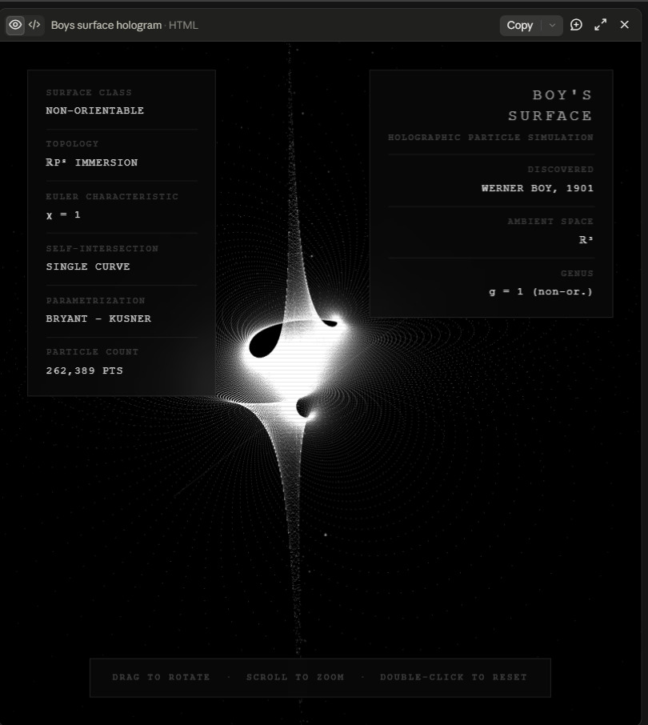

# Boy's Surface — Holographic Particle Simulation

> A non-orientable manifold with no boundary and a single self-intersection curve, rendered as a dense holographic particle field.

**[Live Demo →](https://your-demo-link-here)**

---

## What is Boy's Surface?

Discovered by Werner Boy in 1901, Boy's Surface is an immersion of the real projective plane ℝP² into three-dimensional space. Unlike a sphere or a torus, it is non-orientable — it has no inside or outside — and it intersects itself along a single curve rather than avoiding itself entirely.

It lives in the same family of strange objects as the Klein bottle and the Möbius strip, but it is the only one that can be immersed in ℝ³ without pinch points.

Key properties:

- **Euler characteristic:** χ = 1
- **Topology:** ℝP² immersion
- **Self-intersection:** single curve
- **Orientability:** none
- **Boundary:** none

---

## Parametrization

The surface is computed via the **Bryant–Kusner rational map**. Each point on the 2-sphere (θ, φ) is projected stereographically to a complex number *w*, then passed through a rational function to yield coordinates in ℝ³:
